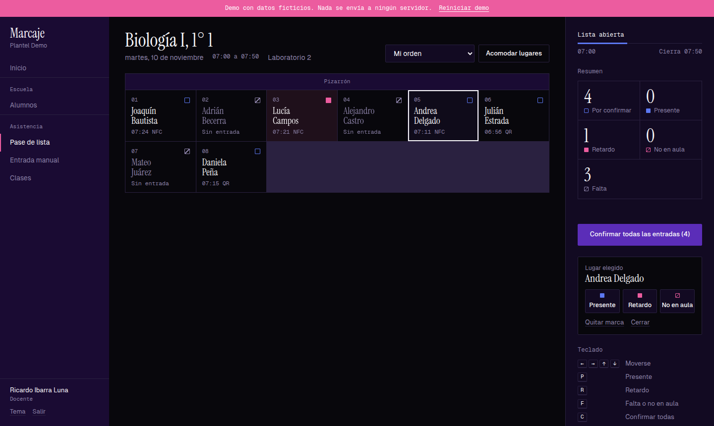
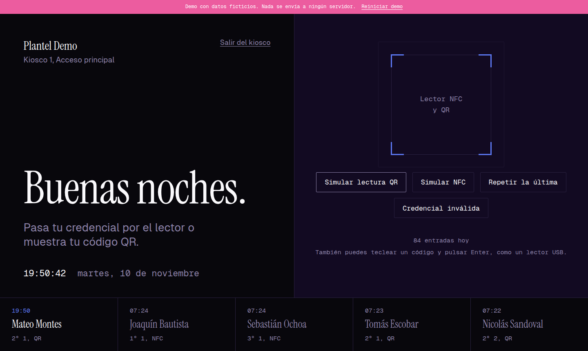
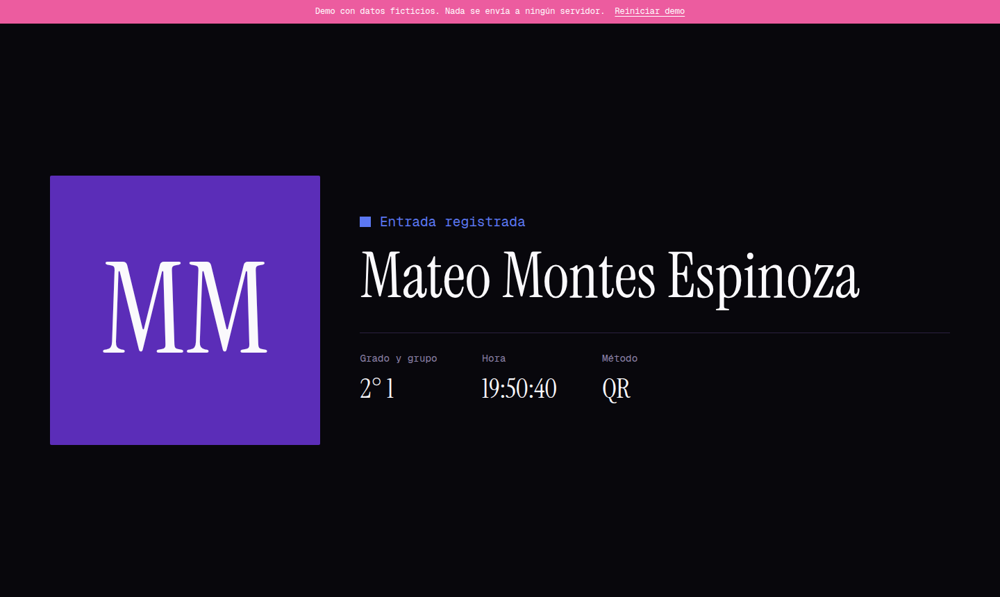
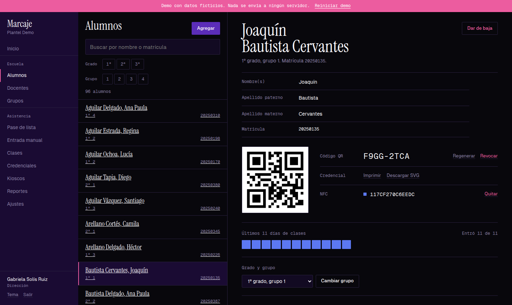
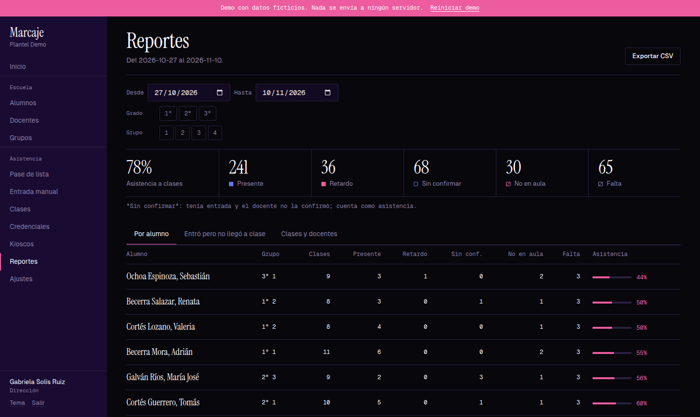
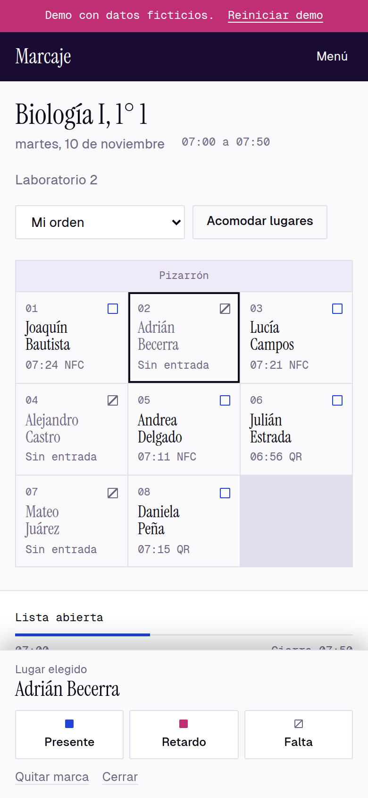
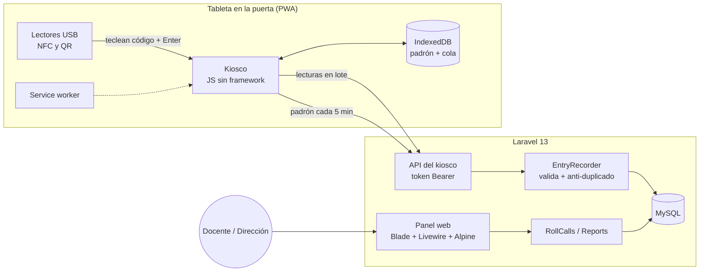

# Marcaje

**Pase de lista para escuelas con credenciales QR y NFC.** Los alumnos registran su entrada en un kiosco y el docente pasa lista en clase viendo quién entró y a qué hora.

**[Probar la demo](https://enriqueleondev.github.io/marcaje-demo/)** (datos ficticios, sin registro) · [Código de la demo](https://github.com/enriqueleondev/marcaje-demo)



## El problema

En muchas escuelas la asistencia se pasa en papel o en una hoja de cálculo, clase por clase, nombrando a cada alumno. Toma tiempo de clase, no dice si un alumno que "faltó" sí llegó a la escuela y se quedó fuera del aula, y dirección se entera tarde.

Marcaje separa dos momentos:

1. **Entrada a la escuela.** El alumno acerca su credencial (pegatina NFC o código QR) a una tableta en la puerta. Toma un segundo y funciona aunque se caiga el internet.
2. **Pase de lista en clase.** El docente abre su lista y cada alumno ya aparece con su hora de entrada. Confirma a todos de un clic y solo corrige excepciones: retardo, falta, o "no en aula" (entró a la escuela pero no llegó a clase).

Dirección ve en los reportes quién falta más, quién entró pero no llegó a clase y qué docentes no pasan lista.

## Capturas

| Kiosco de entrada | Confirmación (1.5 s, con sonido) |
|---|---|
|  |  |

| Alumnos y credencial QR | Reportes |
|---|---|
|  |  |



## Qué hace

- **Kiosco (PWA)** para tabletas: lectores USB de NFC y QR, confirmación a pantalla completa, cola sin conexión y anti-duplicado.
- **Pase de lista** en una retícula de lugares: táctil (botones de 44 px como mínimo) o con teclado (`P`, `R`, `F`, `C`), "confirmar todas las entradas", 5 órdenes y lugares que el docente acomoda arrastrando. Solo se edita durante el horario de la clase.
- **Credenciales**: código QR aleatorio de 8 caracteres (sin 0/O/1/I y nunca derivado de datos personales), UID de NFC vinculado desde el panel, regenerar y revocar, impresión en tamaño tarjeta.
- **Alumnos, docentes y grupos**: alta masiva por CSV (todo o nada, con errores por línea), contraseñas temporales de 24 h y clases que cada docente arma.
- **Entrada manual** con motivo obligatorio para quien olvidó su credencial.
- **Reportes** por alumno, "entró pero no llegó a clase", entradas manuales y clases sin pase de lista, con exportación a CSV.
- **Roles**: dirección (todo) y docente (ve a todos los alumnos, pero solo edita a los de sus clases). Los alumnos no tienen cuenta.

## Arquitectura



- **Una instalación por cliente** (su subdominio y su base de datos). Lo propio de cada escuela (nombre, zona horaria, grados, minutos del anti-duplicado) vive en la tabla `settings` y se edita en Ajustes, no en el código.
- El modelo de datos está documentado en [`docs/modelo-datos.md`](docs/modelo-datos.md).

## Decisiones técnicas

**El kiosco funciona primero con datos locales.** Al vincularse descarga el padrón (código → alumno) y lo guarda en IndexedDB, así que identifica al alumno al instante aunque no haya red. Cada lectura entra a una cola local y se envía en lote. Al recargar sin conexión, un service worker sirve la página guardada.

**El servidor tiene la última palabra.** `EntryRecorder` vuelve a validar cada lectura: credencial activa, alumno activo y la hora del dispositivo (si viene adelantada se usa la del servidor; si tiene más de 7 días se rechaza). Cada lectura lleva un UUID único, así que una cola que se reenvía no duplica entradas.

**Anti-duplicado en dos capas.** La tableta ignora al mismo alumno durante 5 minutos (configurable) para responder rápido, y el servidor aplica la misma ventana alrededor de la hora real de la lectura. Así funciona también entre dos kioscos y con lecturas que llegan tarde desde la cola.

**Lectores como teclado.** Los lectores NFC y QR son dispositivos USB HID: "teclean" el código y Enter. El kiosco captura el teclado globalmente, sin campo enfocado, y distingue al lector de una persona por la velocidad entre teclas. El QR codifica solo letras y números, sin guion, para que cualquier lector lo teclee igual sin importar el idioma del teclado de la tableta.

**La base de datos garantiza las reglas de credenciales.** Columnas generadas (`active_value`, `active_student`) con índices únicos impiden que un código o pegatina activos pertenezcan a dos alumnos, o que un alumno tenga dos QR activos, sin perder el historial de credenciales revocadas.

**"No en aula" sin un estado extra.** Se guarda igual que una falta (`absent`) y se distingue por si hubo entrada ese día. Así los reportes pueden filtrar "entró pero no llegó a clase" sin duplicar información.

**Seguridad** (detalle en [`docs/seguridad.md`](docs/seguridad.md)):
- **Cabeceras:** CSP con nonce por petición (más estricta en el kiosco), HSTS, `X-Frame-Options`, `nosniff`, `Referrer-Policy` y `Permissions-Policy`.
- **Login:** bloqueo de 15 minutos por cuenta y por IP; contraseñas temporales que vencen y obligan a cambiarse.
- **Token del kiosco:** se guarda solo su SHA-256, es revocable y tiene límite de peticiones.
- **CSV:** los exportados neutralizan fórmulas (`=`, `+`, `-`, `@`).
- **Bitácora:** registra altas, bajas, contraseñas, credenciales, entradas manuales y accesos.

## Pruebas

**140 pruebas automatizadas** (PHPUnit, más de 1,400 aserciones):

| Área | Pruebas | Qué cubren |
|---|---|---|
| Alumnos, docentes, grupos y credenciales | 45 | CSV de todo o nada (Excel, Windows-1252, punto y coma), regenerar y revocar QR, una pegatina por alumno, QR descargado que se vuelve a leer como imagen |
| Acceso | 22 | Inicio de sesión, contraseñas temporales y su vencimiento, cuentas desactivadas |
| Seguridad | 20 | Todas las rutas de dirección contra un docente, IDOR, ids bloqueados en Livewire, cabeceras y CSP, bloqueo de login, límite del kiosco, CSV, bitácora |
| Kiosco y entrada manual | 19 | API, idempotencia por UUID, ventana anti-duplicado, hora del dispositivo, padrón por versiones |
| Pase de lista | 18 | Ventana de edición, estados, "confirmar todas", órdenes y acomodo de lugares, entradas del kiosco durante la clase |
| Reportes | 10 | Reglas de conteo, filtros, sesiones sin pase de lista, exportación |
| Otras | 6 | Comandos de consola y generador de contraseñas |

Además, los flujos de la interfaz se probaron en Chrome con Playwright: teclado y arrastre del pase de lista (mouse y táctil), kiosco con y sin conexión, y que la CSP no bloquee nada.

```bash
php artisan test
```

## Stack

- **Backend:** PHP 8.3+, Laravel 13, MySQL 8 (SQLite en desarrollo y pruebas).
- **Panel:** Blade, Livewire 4, Alpine, CSS propio con tokens de diseño, sin framework de CSS.
- **Kiosco:** JavaScript sin framework, IndexedDB, service worker, Web Audio y Wake Lock.
- **QR:** `chillerlan/php-qrcode` (SVG y PNG).
- **Herramientas:** Vite, Pint, PHPUnit, Docker (MySQL local) y cloudflared (HTTPS para probar en la tableta).

## Correrlo en local

Requisitos: PHP 8.3+ con `intl`, `gd` y `pdo_sqlite`, Composer y Node 20+.

```bash
git clone https://github.com/enriqueleondev/marcaje-app.git && cd marcaje-app
composer install && npm install && npm run build
cp .env.example .env && php artisan key:generate
touch database/database.sqlite && php artisan migrate --seed
php artisan serve
```

Entra en http://localhost:8000 con `direccion@example.com` o `docente@example.com` (contraseña `password123`). El kiosco está en `/kiosco`: créalo y vincúlalo desde Kioscos.

**Modo producción en local**, con MySQL en Docker, unos 300 alumnos de prueba y túnel HTTPS para la tableta: ver [`docs/pruebas-produccion.md`](docs/pruebas-produccion.md).

## Licencia

[PolyForm Noncommercial 1.0.0](LICENSE.md): puedes leer, ejecutar y modificar el código con fines no comerciales (aprender, evaluar, uso personal). **No se permite el uso comercial.** Si te interesa usarlo en tu escuela o empresa, escríbeme desde [mi portafolio](https://enriqueleondev.github.io/).

Las dependencias conservan sus propias licencias (Laravel y la mayoría de paquetes: MIT; tipografías Instrument Serif y Geist: SIL OFL 1.1).

---

Hecho por **Enrique Rentería León**. [Portafolio](https://enriqueleondev.github.io/)
